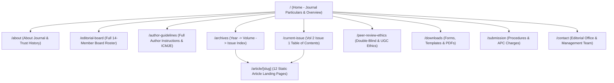

# System Architecture & Technical Specifications

> **JMN Journal of Medical Sciences**  
> Official Biannual, Peer-Reviewed Medical Journal of JMN Medical College & Hospital

---

## 1. Framework & Core Specifications

- **Framework**: Next.js 16+ (App Router, Turbopack engine)
- **Language**: TypeScript 5
- **Styling**: Tailwind CSS with custom editorial palette tokens
- **Output Mode**: Static Site Export (`output: 'export'`)
- **Image Optimization**: Static unoptimized export (`images: { unoptimized: true }`)
- **Metadata Standard**: Dublin Core & Highwire Press academic indexing meta tags
- **Fonts**:
  - Masthead: Cormorant Garamond (`serif`)
  - Headlines: Source Serif 4 (`serif`)
  - Body & UI: Inter (`sans-serif`)

---

## 2. Sitemap & Route Hierarchy

All pages are generated at build-time as static HTML pages (`● SSG` and `○ Static`).



### Static Route Inventory (26 Prerendered Pages)
- **Root Pages (10)**:
  - `/` (Home)
  - `/about`
  - `/editorial-board`
  - `/author-guidelines`
  - `/current-issue`
  - `/archives`
  - `/peer-review-ethics`
  - `/downloads`
  - `/submission`
  - `/contact`
- **Dynamic SSG Route (`/article/[slug]`) (12 Pages)**:
  - `/article/2026-v2-i1-article-01`
  - `/article/2026-v2-i1-article-02`
  - `/article/2026-v2-i1-article-03`
  - `/article/2026-v2-i1-article-04`
  - `/article/2026-v2-i1-article-05`
  - `/article/2026-v2-i1-article-06`
  - `/article/2025-v1-i1-article-01`
  - `/article/2025-v1-i1-article-02`
  - `/article/2025-v1-i1-article-03`
  - `/article/2025-v1-i1-article-04`
  - `/article/2025-v1-i1-article-05`
  - `/article/2025-v1-i1-editorial`
- **Utility / Special Routes (4)**:
  - `/_not-found`
  - `/icon.png`
  - `/favicon.ico`
  - `/robots.txt`

---

## 3. Design System Tokens

```css
:root {
  --color-primary: #5B1E1E;   /* Maroon masthead accent & links */
  --color-secondary: #F5EFE6; /* Cream surface cards & badges */
  --color-border: #E8D5B5;    /* Subtle cream/gold divider border */
  --color-accent: #B8860B;    /* Gold category tags & indicators */
  --color-bg: #FDFBF8;        /* Warm off-white page background */
  --font-masthead: 'Cormorant Garamond', Georgia, serif;
  --font-headline: 'Source Serif 4', Georgia, serif;
  --font-body: 'Inter', system-ui, -apple-system, sans-serif;
}
```

---

## 4. Issue Registry & Bibliographic Utilities (`lib/issues.ts`)

A centralized, type-safe registry manages volume definitions, issue dates, and Vancouver citation generation:

```typescript
export interface IssueMeta {
  year: number;
  volume: number;
  issue: number;
  period: string;          // e.g. "January–June" or "July–December"
  periodShort: string;     // e.g. "Jan–Jun" or "Jul–Dec"
  fullLabel: string;       // e.g. "Volume 2, Issue 1, January–June 2026"
  bibLabel: string;        // e.g. "Volume 2, Issue 1, Jan–Jun 2026"
  folder: string;          // e.g. "2026-v2-i1"
  coverUrl: string;        // e.g. "/articles/2026-v2-i1/cover-page.pdf"
  fullIssueUrl: string;    // e.g. "/articles/2026-v2-i1/full-issue.pdf"
}
```

### Citation Engine
Generates standardized Vancouver citations with the official NLM/PubMed-style journal abbreviation:
```
Sahoo R, Hari R. Surgical Management of Impacted Mesiodens in Pediatric Patients: A Case Series. JMN J Med Sci. 2025 Jul–Dec;1(1):26–30.
```

---

## 5. Data Schema for Issues (`content/issues/*.json`)

```json
{
  "year": 2026,
  "volume": 2,
  "issue": 1,
  "month": "January-June",
  "period": "January–June 2026",
  "fullIssuePdf": "/articles/2026-v2-i1/full-issue.pdf",
  "coverPdf": "/articles/2026-v2-i1/cover-page.pdf",
  "articles": [
    {
      "id": "article-01",
      "slug": "2026-v2-i1-article-01",
      "type": "Original Article",
      "title": "Knowledge, Attitude, and Practice on Cervical Cancer Screening Among Tribal Women",
      "authors": ["Author One", "Author Two"],
      "affiliations": ["Department of Community Medicine..."],
      "pages": "1-5",
      "firstPage": 1,
      "lastPage": 5,
      "pdfUrl": "/articles/2026-v2-i1/article-01.pdf",
      "abstract": "Background: Cervical cancer remains a major public health concern...",
      "keywords": ["Cervical Cancer", "Screening", "Tribal Health", "Pap Smear"]
    }
  ]
}
```

---

## 6. PDF Processing & Bibliographic Tooling (`tools/pdf-bibliographic/`)

The repository includes reproducible Python automation tools based on PyMuPDF (`fitz`):

1. **`fixpdfs.py`**:
   - Searches and redacts outdated running footers using exact bounding box redactions.
   - Adds a standardized first-page bibliographic header strip: `JMN Journal of Medical Sciences • Volume X, Issue Y, Period • pp. a–b`.
   - Adds a uniform running footer on every subsequent page with the journal name and continuous pagination.
   - Updates embedded PDF metadata (`/Title`, `/Author`, `/Subject`, `/Keywords`).

2. **`build_issue.py`**:
   - Assembles high-resolution cover page, auto-generated contents/editorial page, individual article PDFs in exact order, author guidelines, and back cover.
   - Embeds PDF table of contents bookmarks for direct navigation in PDF readers.

---

## 7. Compliance Architecture

- **ISSN India Standards**:
  - Uniform Subject identifier: `"Medical Sciences"`.
  - Strict volume-per-calendar-year structure (`2025 = Volume 1`, `2026 = Volume 2`).
  - Zero login requirements or paywalls.
  - Complete selectable plain-text particulars.
- **Academic Indexing**:
  - Highwire Press meta tags (`citation_*`) emitted on all article pages.
  - Dublin Core meta tags (`DC.*`) for open digital repository compatibility.
